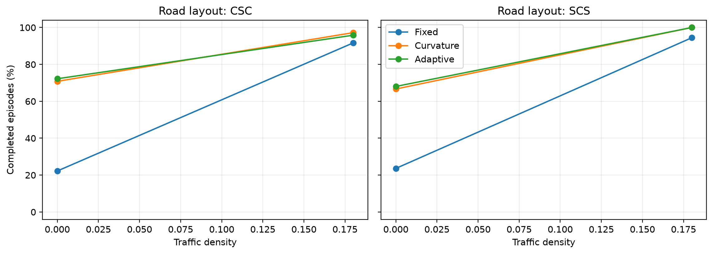
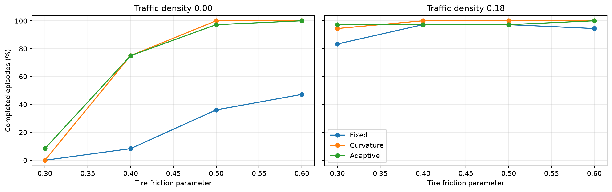

# 🚗 TFRG-MetaDrive

### Autonomous Robotic Vehicle Safety Under Varying Friction, Traffic, and Road Geometry: A MetaDrive-Based Study

TFRG-MetaDrive is a reproducible Python experiment for investigating how tire friction, road geometry, and surrounding traffic affect the safety and route completion of autonomous robotic vehicles in the [MetaDrive](https://github.com/metadriverse/metadrive) simulator.

The repository contains the experimental code, controller implementations, validation tests, and results from a locally executed MetaDrive study. The focus is on **evaluating operating conditions and speed-governor behavior**, rather than proposing a new driving policy.

## 🔎 Research objectives

- Quantify route completion and failure modes across tire-friction settings.
- Compare performance on two procedural road layouts, `CSC` (curve–straight–curve) and `SCS` (straight–curve–straight).
- Measure the effect of absent versus active surrounding traffic.
- Evaluate three speed governors under matched simulation conditions.
- Provide auditable CSV outputs and publication-ready figures.

## 🧪 Experimental design

| Parameter | Configuration |
|---|---|
| Simulator | MetaDrive 0.4.3 |
| Programming language | Python 3.11 |
| Road layouts | `CSC`, `SCS` |
| Tire-friction settings | `0.30`, `0.40`, `0.50`, `0.60` |
| Requested traffic density | `0.00` (none), `0.18` (active) |
| Speed governors | Fixed, Curvature, Adaptive |
| Scenario seeds | 18 |
| Total benchmark episodes | **864** |
| Maximum episode length | 700 simulation steps |

The same scenario conditions are evaluated across the three governors. The experiment also measures actual traffic presence and vehicle proximity; the density parameter is **not** interpreted as vehicles per hour or as an observed roadway occupancy percentage.

### 🚘 Compared speed governors

- **Fixed:** uses a constant reference speed of 50 km/h.
- **Curvature:** reduces the reference speed according to estimated road curvature and a lateral-acceleration limit.
- **Adaptive:** additionally uses lateral deviation and heading error to adjust the curvature-based speed reference.

All three methods share the same MetaDrive `IDMPolicy` for steering and traffic interaction. They are speed-governor configurations, not three independently trained driving agents. None receives the simulator's tire-friction coefficient as a control input.

## 📊 Recorded results

The full local experiment recorded **864 episodes** and **282,517 simulation-step observations**.

| Metric | No traffic (`d = 0.00`) | Active traffic (`d = 0.18`) |
|---|---:|---:|
| Route completion | 53.9% | 96.5% |
| Mean vehicle speed | 37.97 km/h | 27.80 km/h |
| Vehicle collisions | 0 | 7 |
| Road departures | 199 | 8 |

The greater completion rate observed with traffic coincided with lower mean speed. This is an **association within the tested simulation configuration**, not evidence that introducing traffic is inherently safer or that speed reduction is its only explanation. Vehicle collisions and road departures are reported separately.

### 📈 Example figures

**Route completion across traffic conditions and road layouts**



**Route completion across tire-friction and traffic settings**



Additional PNG and PDF figures are available in [`results/traffic_full_20261107_212426/figures/`](results/traffic_full_20261107_212426/figures/).

## 🛠️ Installation

A Windows machine with **Python 3.10 or 3.11** is required by the supplied installation script; Python 3.11 is recommended. MetaDrive must be installed along with the packages in `requirements.txt`.

```powershell
git clone https://github.com/vitor-souza-ime/tfrg-metadrive.git
cd tfrg-metadrive
.\INSTALL_WINDOWS.bat
```

The installer creates a local `.venv`, installs the required packages, checks dependency compatibility, and executes the Python tests.

## ▶️ Run the experiment

From the project directory in Windows PowerShell:

```powershell
.\RUN_FULL.bat
```

This script runs the automated tests, performs the mandatory traffic preflight when needed, executes the full experiment, audits the CSV files, generates figures, and creates a compressed result archive.

For a smaller check, or to inspect the planned number of episodes:

```powershell
.\.venv\Scripts\python.exe main.py --profile smoke
.\.venv\Scripts\python.exe main.py --profile full --plan
```

To explicitly verify the two traffic treatments before the full run:

```powershell
.\.venv\Scripts\python.exe main.py --profile preflight --skip-visual
```

To regenerate analysis from a **complete local run directory** containing both `episodes.csv` and `steps.csv`, without rerunning the simulator:

```powershell
.\.venv\Scripts\python.exe main.py --analyze "results\traffic_full_YYYYMMDD_HHMMSS"
```

Replace the example directory with the actual output folder. Large per-step CSV files and rendered captures are generated locally and may not be included in the tracked GitHub files.

## 📁 Repository structure

```text
tfrg-metadrive/
├── main.py                   # Command-line entry point
├── traffic_friction/
│   ├── protocol.py           # Experimental configurations and seeds
│   ├── controllers.py        # Fixed, curvature and adaptive governors
│   ├── collect.py            # MetaDrive data collection
│   ├── analysis.py           # Integrity checks, statistics and plots
│   └── rendering.py          # Simulation captures
├── tests/                    # Automated validation tests
├── results/                  # Recorded outputs and figures
├── requirements.txt
├── INSTALL_WINDOWS.bat
├── RUN_FULL.bat
└── LICENSE
```

## 🧾 Reproducibility and data integrity

- Experimental configurations and scenario seeds are stored in `traffic_friction/protocol.py`.
- The benchmark records individual episodes and simulation steps in CSV format.
- Traffic treatments are checked against observed vehicle presence, not just requested density values.
- The analysis checks for missing or duplicate episode records and produces audit information.
- Comparisons use matched scenarios, with uncertainty estimates obtained by resampling scenario seeds rather than treating successive time steps as independent observations.
- Rendered screenshots and animations are excluded from the benchmark statistics.

The tracked [`results`](results/) directory includes the episode-level dataset and generated figures. For a complete re-analysis that also uses the step-level measurements, retain the corresponding `steps.csv` from the local experiment archive.

## 📚 Research use

This project supports a simulation-based study of autonomous robotic vehicle safety. All quantitative findings refer to **MetaDrive simulations**, not tests on physical vehicles or public roads. Results should be interpreted within the stated controller and environment configurations.

Repository: https://github.com/vitor-souza-ime/tfrg-metadrive

## 📄 License

This repository is released under the [MIT License](LICENSE).
